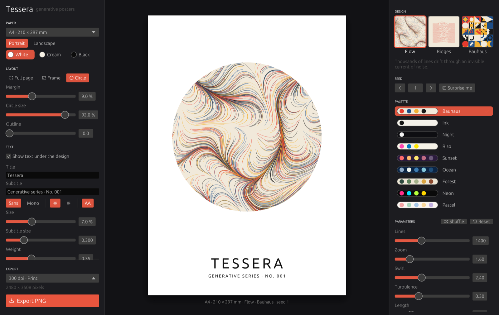
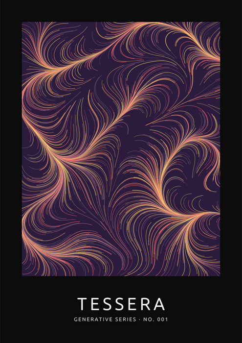
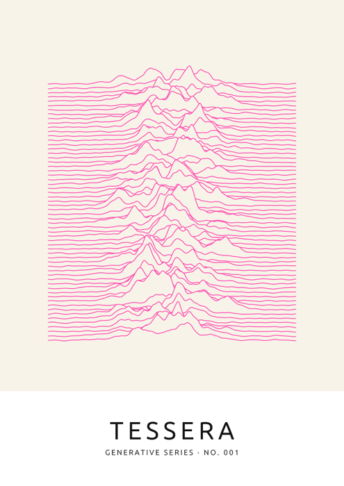
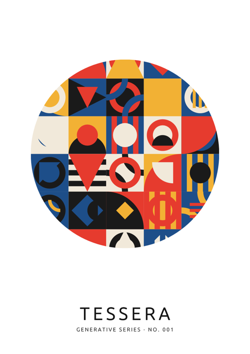

# Tessera

Generative posters. Tessera draws them for you: pick a design, turn the knobs
until you like it, add a title, export a print-ready PNG.



<p>
  
  
  
</p>

## How it works

- **Middle:** the poster, always shown at its real proportions.
- **Right – Design:** choose one of the designs, a seed and a palette, then
  shape it with the parameters. *Surprise me* (or <kbd>Space</kbd>) rolls a new
  seed; <kbd>←</kbd> / <kbd>→</kbd> step through seeds; *Shuffle* tries random
  parameters, *Reset* brings back the defaults.
- **Left – Format:** paper size (A5 – A2, square, 4:5), portrait or landscape,
  paper colour (white, cream, black) and the layout:
  - **Full page** – the design covers the whole sheet
  - **Frame** – the design in a rectangle with a margin
  - **Circle** – the design in a circle, the rest stays paper
  
  Below that the text: title and subtitle, typeface, size, weight, letter
  spacing, capitals, alignment.
- **Export PNG** (<kbd>⌘E</kbd>) at 300 dpi (print), 150 dpi or 72 dpi. The
  resolution is stored in the file, so an A4 export prints at exactly A4
  (2480 × 3508 pixels at 300 dpi).

The same seed and settings always give the same poster – note the seed if
you want to come back to one. Settings are remembered between launches.

## Designs

| Design | What it draws | Knobs |
|---|---|---|
| **Flow** | Thousands of lines following an invisible current of Perlin noise | lines, zoom, swirl, turbulence, length, line width, opacity, direction |
| **Ridges** | Stacked mountain lines, each hiding the ones behind it | lines, height, focus, roughness, line width, padding, solid, colourful |
| **Bauhaus** | A grid of tiles with quarter circles, half circles, rings, triangles and stripes | columns, layers, curves, plain tiles, calm, gutter |

Nine palettes: Bauhaus, Ink, Night, Riso, Sunset, Ocean, Forest, Neon, Pastel.

## Build it yourself

You need [Rust](https://rustup.rs).

```bash
cargo run --release
```

On a Mac, `./scripts/build-mac.sh --install` builds `Tessera.app` and copies it
to `/Applications`. The app is only signed locally, so the first launch needs
*Open Anyway* in System Settings → Privacy & Security.

## Credits

Built with [egui](https://github.com/emilk/egui) and
[tiny-skia](https://github.com/linebender/tiny-skia). Poster text uses the
fonts that ship with egui: Ubuntu Light (Ubuntu Font Licence) and Hack
(MIT / Bitstream Vera licence).

## Licence

MIT – see [LICENSE](LICENSE).
